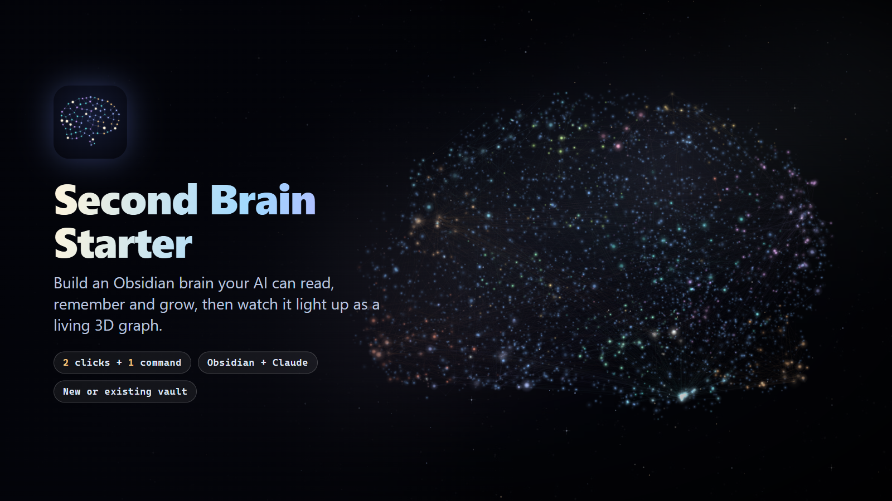
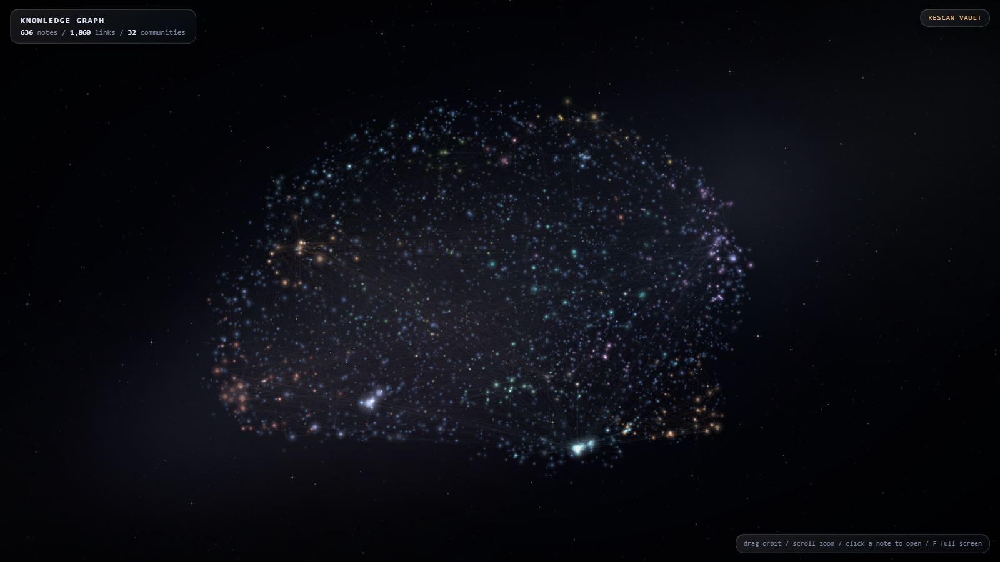
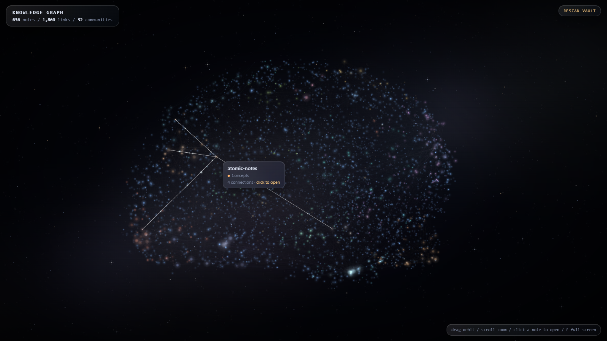
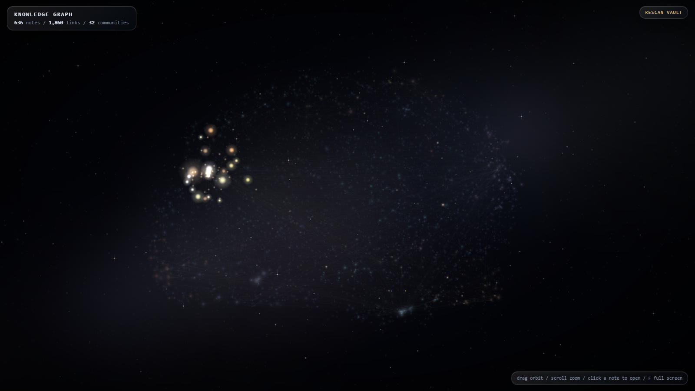
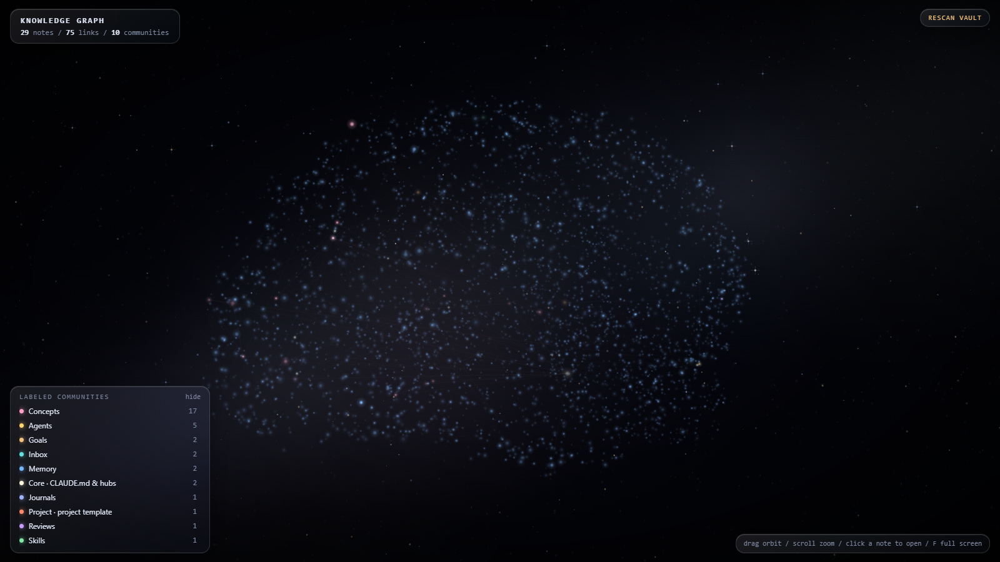
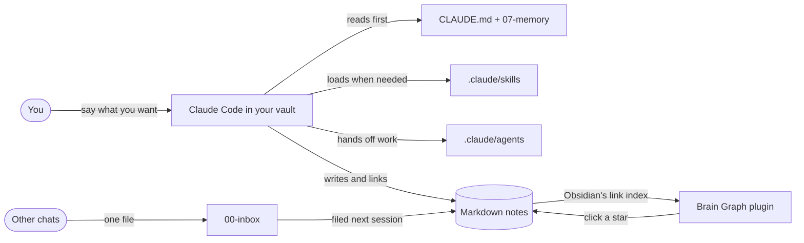

<p align="center">
  
</p>

# Second Brain Starter

**Build an Obsidian brain your AI can read, remember and grow, then watch it light up as a living 3D graph.**

An AI chat forgets you the moment it closes. This kit gives it a place to remember:
a folder of plain notes, a short set of rules written from a conversation with *you*,
memory the AI can read and you can edit, optional helper agents, and a
**Brain Graph** plugin that draws your real notes and links as a glowing brain.

It is the same setup its author uses every day, with everything personal removed.

> **Time:** about 10 minutes. **Clicks:** two. **Commands:** one. **Cost:** the kit is free
> (MIT). You need Obsidian (free for personal use) and Claude Code (needs a Claude plan).

---

## Pick your path

| | **A. I don't have a second brain yet** | **B. I already have one** |
|---|---|---|
| You get | A complete starter vault: folders, skills, helper agents, 17 linked concept notes | Your vault **untouched**, plus AI memory, skills and the graph added on top |
| The AI asks you | ~9 short questions (name, who you are, how to talk to you, what it must always ask first...) | ~5 questions, then shows a checklist you approve line by line |
| Risk to your notes | None (empty folder) | **None.** Add-only, with backups, and you can undo it |
| Guide | [docs/01-new-brain.md](docs/01-new-brain.md) | [docs/02-connect-existing.md](docs/02-connect-existing.md) |

Not sure? If you have notes in Obsidian today, it's **B**. Otherwise **A**.

---

## Quick start

### The easiest way: let Claude install it
1. Download this repo (green **Code** button, **Download ZIP**) and unzip it, or `git clone` it.
2. Open **Claude Code in that folder** and say: **`Set up my second brain.`**

The repo's [`CLAUDE.md`](CLAUDE.md) turns Claude into the installer. It asks where to put the
vault, shows a dry run, installs, and walks you through the two clicks. (Browser steps, like
downloading Obsidian, can use the Claude in Chrome extension, with
[safety rules](docs/04-claude-in-chrome-safely.md).)

### The by-hand way

**A. New brain**

```powershell
# Windows (PowerShell)
powershell -ExecutionPolicy Bypass -File setup\install.ps1 -Vault "$HOME\Documents\My Brain" -Mode New
```
```bash
# macOS / Linux (needs Node 18+)
node setup/install.mjs --vault "~/Documents/My Brain" --mode new
```
Then:
1. **Click 1:** Obsidian → *Open folder as vault* → pick that folder.
2. **Click 2:** *Turn on community plugins* (if Obsidian asks). Press **Ctrl+G**: your brain appears.
3. **Command:** in a terminal in that folder run `claude`, and say **`set me up`**.

**B. Existing vault**

```powershell
powershell -ExecutionPolicy Bypass -File setup\install.ps1 -Vault "D:\Notes\MyVault" -Mode Connect -DryRun   # look first
powershell -ExecutionPolicy Bypass -File setup\install.ps1 -Vault "D:\Notes\MyVault" -Mode Connect            # then do it
```
```bash
node setup/install.mjs --vault "~/Notes/MyVault" --mode connect --dry-run
node setup/install.mjs --vault "~/Notes/MyVault" --mode connect
```
Open the vault in Obsidian, turn on community plugins if asked, press **Ctrl+G**, then run
`claude` in the vault and say **`connect my brain`**.

---

## What it looks like

<p align="center">
  <br>
  <sub>A real vault: 636 notes, 1,860 links, 32 communities. Each colour is a folder. The bright column is the core.</sub>
</p>

<table>
<tr>
<td width="50%"><br><sub><b>Hover</b> a note: its links light up and sparks run along them. <b>Click</b> to open it.</sub></td>
<td width="50%"><br><sub><b>Click a folder</b> in the legend and its notes glow and spark.</sub></td>
</tr>
<tr>
<td colspan="2"><br><sub><b>Day one.</b> The starter vault has about 30 linked notes. The faint blue specks are decoration that keeps the brain outline readable; the coloured stars are real notes. It fills in as you write.</sub></td>
</tr>
</table>

**It learns live:** a new note flashes in about 2.5 seconds after Obsidian indexes it, with a
**LEARNED** card, without moving the camera.

---

## What you get

```
your-vault/
├── CLAUDE.md             the AI's job description and your user manual (written by an interview)
├── 00-goals/             what you're aiming at
├── 00-inbox/             drop zone for notes written in other chats (phone, web)
├── 01-notes/             books, courses, videos
├── 02-journals/          one entry per day or session
├── 03-projects/          one folder per project, each with its own CLAUDE.md
├── 04-reviews/           weekly and monthly reviews
├── 05-skills/            notes about your skills
├── 06-agents/            the helper-agent roster and its rules
├── 07-memory/            what the AI remembers + a mistakes log
├── 08-concepts/          17 short linked notes explaining how it all works
└── .claude/
    ├── skills/           brain-setup · new-project · weekly-update · wrap-up
    └── agents/           researcher · reviewer · writer · team-lead
```

| Piece | What it does |
|---|---|
| **`brain-setup` skill** | Interviews you one question at a time and writes your `CLAUDE.md` |
| **`brain-connect` skill** | For existing vaults: scans read-only, proposes additions, applies only what you approve |
| **`wrap-up` skill** | Say "that's all for today": it writes the journal, mistakes log, memory and open loops |
| **Memory as files** | The AI's memory is markdown you can read, fix and carry to any tool |
| **Helper agents** | Four starter agents with one job each, capped on purpose. Rename, remove or give them a personality |
| **Brain Graph plugin** | Your real notes and links as a glowing 3D brain. **Ctrl+G** |

## How it fits together



Want the full story and the reasoning behind every rule?
**[docs/HOW-WE-BUILT-IT.md](docs/HOW-WE-BUILT-IT.md)**

---

## Safety and privacy

- **Add-only.** The installers never overwrite or delete your files. Files that already
  exist are skipped and listed. Settings files are backed up first.
- **Dry run.** `-DryRun` / `--dry-run` shows what would happen and changes nothing.
- **The plugin makes no network requests.** Its 3D page runs in a sandboxed frame that can
  only ask the plugin to *open a note*, *rescan* or *go full screen*. three.js is bundled,
  not downloaded. Check yourself: `grep -nE "fetch\(|XMLHttpRequest|WebSocket" plugin/brain-graph/*.js plugin/brain-graph/*.html` prints nothing.
- **Your notes stay on your computer** except what *you ask Claude to read*, which is sent to
  Claude the way any Claude Code session is. Read Anthropic's privacy terms for your plan.
- **No secrets in the vault.** The skills never ask for or store passwords, ID numbers or bank
  details, and the root `CLAUDE.md` says so.
- **You set the always-ask list.** Spending, posting publicly, messaging people, deleting
  files: the AI asks first, until *you* decide otherwise.
- **Chrome extension / computer control** is optional, with strict rules:
  [docs/04-claude-in-chrome-safely.md](docs/04-claude-in-chrome-safely.md).
- **If you fork this and publish your own brain:** never commit your real vault. This repo
  contains only the empty starter.

## FAQ

**Do I need to know how to code?** No. You paste one command, click twice and answer questions.

**Does it work without Claude?** The notes are plain markdown and the plugin is just Obsidian,
so those work anywhere. The skills and agents are in Claude Code's format.

**Will it change my existing notes?** Path B never moves, renames, reformats or deletes them.
It adds new files and, with your approval, one marked block at the end of an existing `CLAUDE.md`.

**My vault is huge, will the graph cope?** It is built for a few thousand notes. Past that, tell
us what you see in an issue.

**Mac and Linux?** The plugin is cross-platform and `install.mjs` is plain Node. It has been
tested on Windows; macOS/Linux reports are welcome.

**Why "brain-shaped"?** Because it is fun, and because shape makes empty areas obvious: you can
*see* which folders are thin and where your notes aren't connected yet.

## Docs

| | |
|---|---|
| [HOW-WE-BUILT-IT](docs/HOW-WE-BUILT-IT.md) | The story and the reasoning, step by step |
| [01 New brain](docs/01-new-brain.md) | Path A, click by click |
| [02 Connect existing](docs/02-connect-existing.md) | Path B, with undo |
| [03 Brain Graph](docs/03-brain-graph.md) | Controls, how it works, customising |
| [04 Claude in Chrome, safely](docs/04-claude-in-chrome-safely.md) | Browser help with guard rails |
| [05 Troubleshooting](docs/05-troubleshooting.md) | When something doesn't work |

## Credits and licence

Built by [Joe](https://github.com/MarkBasa96) with Claude. MIT licensed: take it, change it,
make it yours. three.js is © the three.js authors (MIT). Obsidian and Claude are products of
their respective owners; this project is not affiliated with either.
