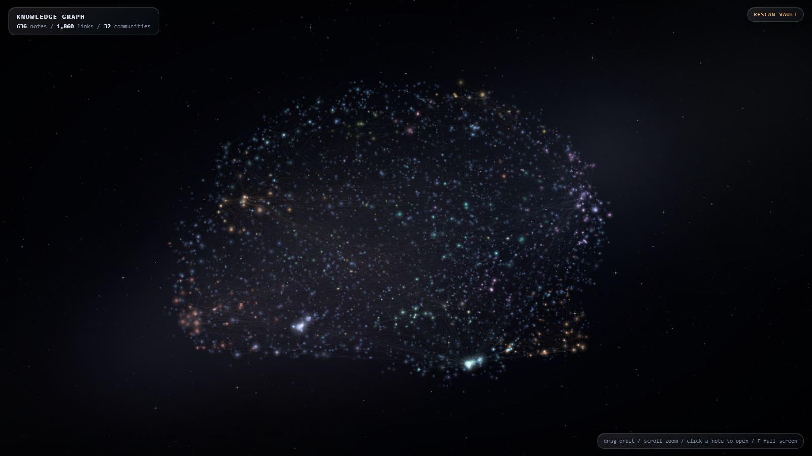
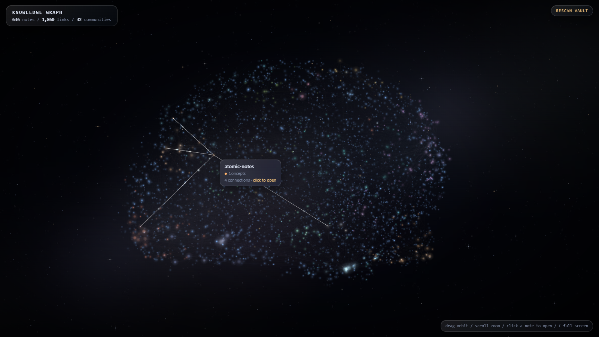
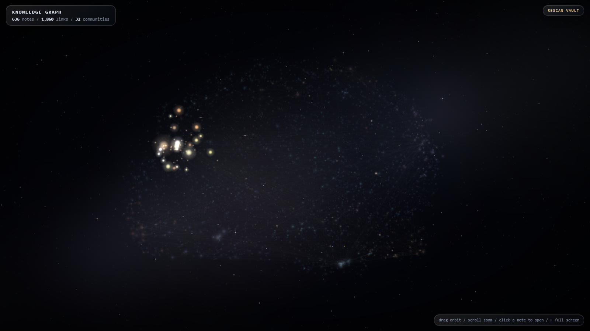

# Brain Graph: the plugin

Your vault as a glowing 3D brain over a night sky. Real notes, real links.



## Open it
- **Ctrl+G** (Cmd+G on Mac). The installer binds this and moves Obsidian's core graph
  off that key. The core graph is still in the command palette.
- Or the **brain icon** in the left ribbon.
- Or the command palette: **Open brain graph**.

Desktop only (Obsidian on phones cannot run it).

## What you are looking at
| You see | It means |
|---|---|
| A star | One note. Bigger = more links. |
| Star colour | Its **community**: its top-level folder. Each project under `03-projects/` gets its own. |
| The bright column down the middle | The **core**: root files and `00-concept-map` / `00-brain-map`, the brainstem |
| A dim grey star | A **ghost**: a link to a note you haven't written yet. Each is work worth doing. |
| ~3,200 faint blue specks | Decoration, so the brain outline reads with few notes. **Not notes.** |
| A thin faint line | A link. Long links that cut across the brain are faded so the shape stays readable. |

## Controls
| Do | Result |
|---|---|
| Drag | Orbit |
| Scroll | Zoom |
| Hover a star | Its links light up and sparks run along them. A card shows the title, folder and link count. |
| Click a star | Opens the note in a new tab |
| Click a name in the **legend** | That community glows and sparks. Click again to let go. |
| **F** | Full screen |
| **RESCAN VAULT** | Force a refresh |




## It learns live
About 2.5 seconds after Obsidian finishes indexing (so you can type without it flickering),
new notes **flash in** with sparks and a **LEARNED** card, without moving the camera. Known
notes keep their spot. A ghost you finally write keeps the ghost's spot.

## How it is built (and why it is safe)
- `main.js` asks Obsidian's own `metadataCache` for resolved and unresolved links, so it
  shows the **same links Obsidian knows**, not a re-parse.
- `graph.html` is the 3D page. It runs inside an **iframe with `sandbox="allow-scripts"`
  only**: it cannot read your files, call the network, or touch Obsidian. It can send
  exactly three messages to the plugin: **open this note** (checked to be a real note in
  your vault), **rescan**, and **full screen**.
- three.js is **shipped inside the plugin** (`vendor/`, MIT). There are no downloads at
  runtime and no network calls anywhere in the plugin code. You can check:
  `grep -nE "fetch\(|XMLHttpRequest|WebSocket" plugin/brain-graph/main.js plugin/brain-graph/graph.html`
  prints nothing.
- The night sky is painted on a canvas when the page opens. There are no image files.
- Hidden folders (`.obsidian`, `.claude`, `.git`) and `node_modules` are skipped.

## Make it fill in: three habits
1. **One idea per note** ([atomic notes](../template/08-concepts/atomic-notes.md)).
2. **Link as you write**: `[[like-this]]`. Linking to a note that does not exist yet is encouraged.
3. **Hub notes.** Keep `08-concepts/00-concept-map.md` (or `00-brain-map.md` in an existing
   vault) linking your big ideas. Hubs are what make the core glow.

## Preview without Obsidian
`tools/preview.mjs` builds a standalone page from any folder of notes, handy for
screenshots and for trying the look before installing:

```bash
node tools/preview.mjs --vault "path/to/notes" --out brain.html
node tools/preview.mjs --vault "path/to/notes" --out brain.html --no-legend   # hide folder names
node tools/preview.mjs --vault "path/to/notes" --out brain.html --focus "08-concepts"
```
Open `brain.html` in any browser. It reads `[[wikilinks]]` itself, so counts can differ a
little from Obsidian's.

## Customise
Everything is plain JS and CSS in `plugin/brain-graph/`. Communities come from
`communityOf()` in `main.js` (one function). The look is in `graph.html`: palette,
glow, dust count, rotation speed. After editing `graph.html` **reload Obsidian**
(Ctrl+P → "Reload app without saving"): the page is read once and cached.

## Credits
three.js (MIT), © three.js authors. See `plugin/brain-graph/vendor/LICENSE`.
